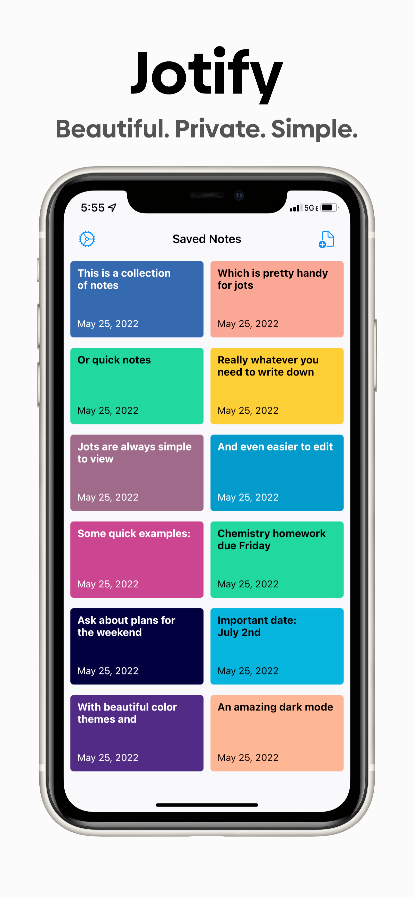
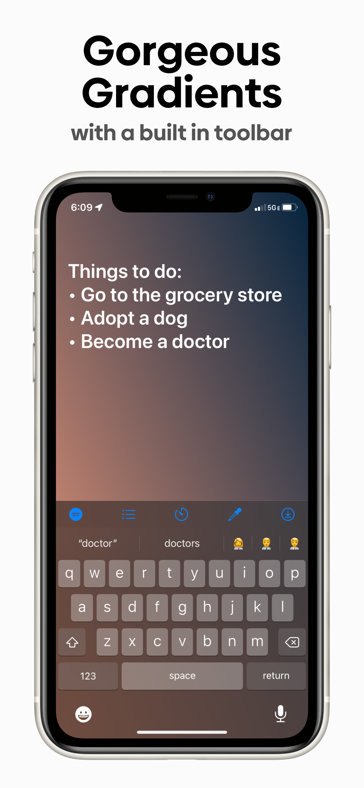

# Jotify

   

## About

Jotify innovates on traditional sticky notes by empowering the user to write a note with ridiculous speed - faster than sending a text. Secure, simple, and blazing fast, Jotify is the perfect companion for your jots and reminders. There is no app more intuitive or beautiful than Jotify, helping you get back to what's important.

Jotify is written in Swift and utilizes Firebase for its backend. I have always kept Jotify open-source for privacy concerns and the benefit of the community. Jotify loosely follows the MVC architecture, and it also contains an implementation of a widget. See below for the project's dependencies.

## Testflight

Want to test the latest features as they come out? Check out Jotify on [Testflight](https://testflight.apple.com/join/EnJVSmNy)!

## App Store

Jotify is available on the [iOS App Store](https://apps.apple.com/us/app/jotify/id1469983730?ls=1) for iPhone and iPad (and unofficially Mac).

## Prerequisites

Jotify builds with Xcode 26 and runs on iOS 18 and newer. Dependencies are fetched by Swift Package Manager when you open the project.

## Local development

Debug builds running in the Simulator use the local [Firebase Emulator Suite](https://firebase.google.com/docs/emulator-suite) instead of production (see `AppDelegate.swift`). It needs Node and JDK 21+.

```bash
npx firebase-tools emulators:start
```

In a second terminal, seed a test account and 40 notes (wipes emulator data first; the test login is at the top of the script):

```bash
node scripts/seed-emulator.mjs
```

The emulator UI is at http://127.0.0.1:4000. To point a Debug simulator build at production instead, set the `USE_PRODUCTION_FIREBASE` environment variable in the scheme. Device builds always use production.

## Dependencies
- [Firebase](https://firebase.google.com) (Swift Package Manager) - Auth and Firestore

Everything else uses Apple frameworks: UIKit and SwiftUI for the interface, StoreKit 2 for Premium, WidgetKit for the Home Screen widget and UserNotifications for reminders.

## Release checklist

Things that live outside this repo and have to be done before (or alongside) the next App Store release:

- [ ] **Invite links: host the apple-app-site-association file on jotifyapp.com.** Referral links are `https://jotifyapp.com/?invitedby=<uid>`, and the app now claims `applinks:jotifyapp.com` (Firebase Dynamic Links / `jotify.page.link` shut down in 2025). Until `https://jotifyapp.com/.well-known/apple-app-site-association` is served (HTTPS, `Content-Type: application/json`, no redirects), tapping an invite link opens the website instead of the app, so referrals don't get credited. Contents:

  ```json
  {
    "applinks": {
      "details": [
        {
          "appIDs": ["G69P7XTUQ3.com.austinleath.Jotify"],
          "components": [{ "/": "/", "?": { "invitedby": "*" } }]
        }
      ]
    }
  }
  ```

- [ ] **App Store privacy label:** Firebase Analytics was removed, so drop the analytics / usage-data entries from the App Privacy section in App Store Connect.
- [ ] **Firestore security rules:** make sure clients can't set `hasPremium` or `referrals` on their own settings document (both are currently written from the app).
- [ ] **Optional:** turn off the iCloud capability on the `com.austinleath.Jotify` App ID in the Apple Developer portal. The app no longer uses iCloud (it was only for importing notes from Jotify 1.x), and the entitlement has been removed.
- [ ] Retake the App Store screenshots and the images in `docs/` (they still show the old design).

## License

This project is licensed under the Apache License 2.0 - see the [LICENSE](LICENSE) file for details
